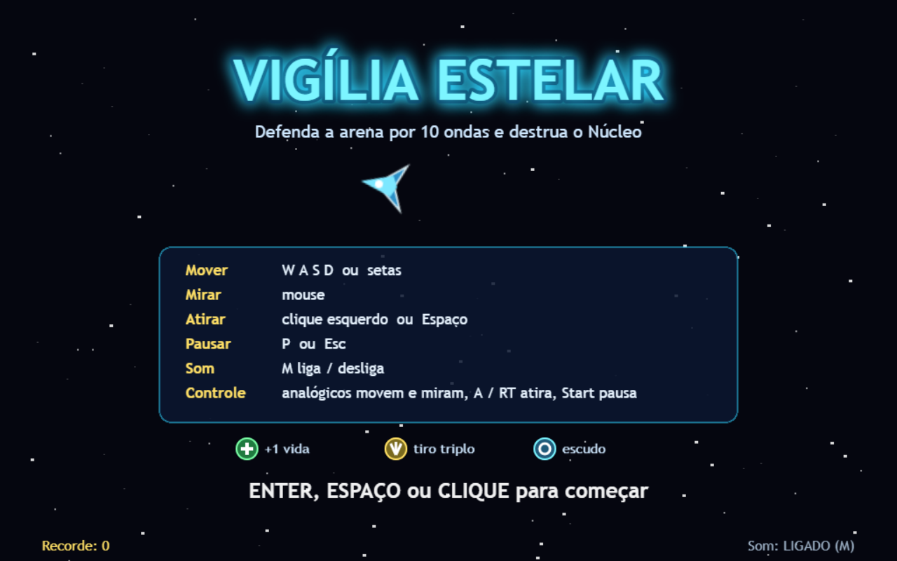
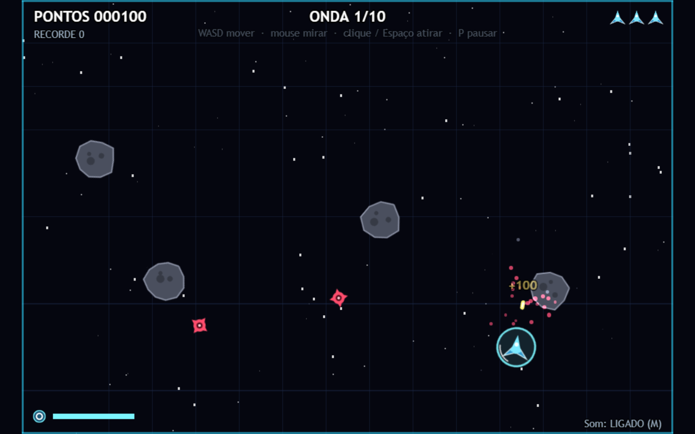
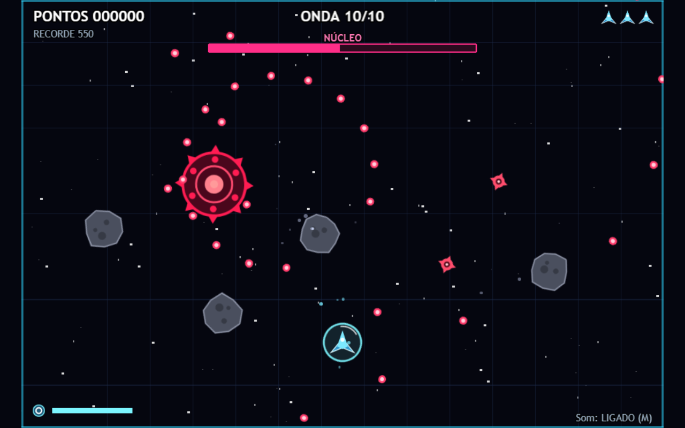

# Vigília Estelar

Jogo 2D de nave e sobrevivência, feito como trabalho individual da disciplina **Desenvolvimento de Jogos Digitais** (Prof. Luis Filipe Grael Tinós).

O jogador pilota uma nave numa arena fechada e precisa sobreviver a **10 ondas** de inimigos. Na última onda aparece o chefe, o **Núcleo**. Destruir o Núcleo é a vitória; perder as 3 vidas é a derrota.

**Jogar no navegador:** https://giovanniandrade99.github.io/vigilia-estelar/



| Partida | Chefe (fase 2) |
|---|---|
|  |  |

## Como executar

Não precisa instalar nada.

- **Online:** abra o link acima.
- **Offline:** baixe o projeto (botão *Code → Download ZIP* ou o `.zip` entregue), extraia e dê **duplo clique em `index.html`**. Funciona no Chrome, Edge e Firefox.

A engine (Phaser) já vem dentro do projeto, em `lib/`. Todas as imagens e sons são gerados por código, então o jogo não depende de arquivos externos nem de internet.

### Atalho para avaliação

Para conferir a onda do chefe e a tela de vitória sem jogar as 10 ondas, abra o jogo com o parâmetro `?onda=N`:

- online: https://giovanniandrade99.github.io/vigilia-estelar/?onda=10
- offline: acrescente `?onda=10` no fim do endereço do `index.html` na barra do navegador

Nesse modo o menu avisa que é uma avaliação e o recorde não é salvo.

## Controles

| Ação | Teclado e mouse | Controle (gamepad) |
|---|---|---|
| Mover | W A S D ou setas | analógico esquerdo |
| Mirar | mouse | analógico direito |
| Atirar | clique esquerdo ou Espaço | A, RB ou RT |
| Pausar / continuar | P ou Esc | Start |
| Voltar ao menu (na pausa) | Q | — |
| Ligar/desligar som | M | — |
| Começar (no menu) | Enter, Espaço ou clique | A ou Start |
| Jogar de novo (tela final) | Enter, Espaço ou clique | A |
| Voltar ao menu (tela final) | Esc | Start |

## Regras

- **Vidas:** 3 no início, máximo 5. Ao levar dano, a nave pisca e fica invulnerável por 1,6 s.
- **Pontos:** drone 100, investida 200, sentinela 250, Núcleo 5000. Cada onda concluída dá um bônus de 250 × número da onda. Na vitória, cada vida restante vale +1000.
- **Recorde:** a melhor pontuação fica salva no navegador.
- **Power-ups** (caem dos inimigos às vezes):
  - verde: +1 vida
  - amarelo: tiro triplo por 8 s
  - azul: escudo por 8 s (absorve tiros e destrói inimigos que encostam)
- **Rochas:** bloqueiam naves e tiros, servem de cobertura.

### Inimigos

| Inimigo | Comportamento (máquina de estados) |
|---|---|
| Drone | persegue o jogador em zigue-zague |
| Sentinela | APROXIMAR → MIRAR (fica amarela) → ATIRAR (rajada de 3) → REPOSICIONAR |
| Investida | VAGAR → CARREGAR (pisca) → INVESTIR (avanço rápido) → RECUPERAR |
| Núcleo (chefe) | ENTRADA → FASE 1 (rajadas circulares e tiros mirados) → FASE 2 abaixo de 50% de vida (mais rápido, mais tiros e invoca drones) |

## Requisitos do trabalho e onde estão no código

| Requisito | Como foi atendido | Onde |
|---|---|---|
| Controle de entradas do jogador | Teclado, mouse e gamepad unificados numa classe só | [`src/input.js`](src/input.js) |
| Movimentação de personagens ou objetos | Nave, 4 tipos de inimigo com movimentos diferentes, tiros, power-ups, rochas girando e fundo em parallax | [`src/entities/`](src/entities/), [`src/systems/Starfield.js`](src/systems/Starfield.js) |
| Uso de Transform e/ou física | **Física (Arcade):** a nave anda por aceleração, com drag, velocidade máxima, rebote e limites do mundo; tiros e inimigos usam velocidade. **Transform:** a nave gira para a mira, o chefe se move alterando `x/y` direto, as estrelas e as rochas são movidas/rotacionadas por código, os power-ups pulsam por tween de escala | [`Player.js`](src/entities/Player.js), [`Enemies.js`](src/entities/Enemies.js) (classe `Nucleo`), [`Starfield.js`](src/systems/Starfield.js) |
| Colisões e interações | `collider` (separa corpos): nave/inimigos/tiros contra rochas, inimigos entre si. `overlap` (regra do jogo): tiro × inimigo, tiro inimigo × nave, nave × inimigo, nave × power-up | [`GameScene.js`](src/scenes/GameScene.js) → `setupCollisions()` |
| Pontuação, vidas, vitória/derrota | Pontos por inimigo e por onda, 3 vidas, recorde salvo, vitória ao destruir o Núcleo, derrota com 0 vidas | [`GameScene.js`](src/scenes/GameScene.js), [`EndScene.js`](src/scenes/EndScene.js) |
| Controle de estados ou comportamentos | Cenas (Menu → Jogo ⇄ Pausa → Fim); estados da nave (NORMAL, INVULNERÁVEL, ESCUDO, DESTRUÍDO); máquina de estados de cada inimigo e do chefe; máquina de estados das ondas | [`Player.js`](src/entities/Player.js), [`Enemies.js`](src/entities/Enemies.js), [`WaveManager.js`](src/systems/WaveManager.js) |
| Interface e feedback ao jogador | HUD (pontos, recorde, onda, vidas, tempo dos power-ups, barra de vida do chefe), avisos de onda, texto "+pontos", partículas de explosão, tremor e flash de câmera, nave piscando, inimigos avisando antes de atacar, sons | [`HUDScene.js`](src/scenes/HUDScene.js), [`GameScene.js`](src/scenes/GameScene.js), [`audio.js`](src/audio.js) |

## Estrutura do projeto

```
index.html              página do jogo (carrega a engine e os scripts)
style.css
lib/phaser.min.js       engine Phaser 3.80.1
src/config.js           constantes de balanceamento, recorde e parâmetro ?onda=
src/audio.js            efeitos sonoros sintetizados (Web Audio API)
src/textures.js         desenho das texturas por código
src/input.js            controle de entradas (teclado, mouse, gamepad)
src/entities/           Player, inimigos (Drone, Sentinela, Investida, Núcleo) e PowerUp
src/systems/            WaveManager (ondas) e Starfield (fundo)
src/scenes/             Boot, Menu, Game, HUD, Pause, End
docs/                   capturas de tela do README
```

## Tecnologias

- [Phaser 3.80.1](https://phaser.io/) (licença MIT): engine 2D para navegador, com Arcade Physics, cenas, câmera, tweens e partículas
- JavaScript, sem etapa de build
- Web Audio API para os sons

## Autor

Giovanni Andrade ([GiovanniAndrade99](https://github.com/GiovanniAndrade99)). Trabalho individual.
